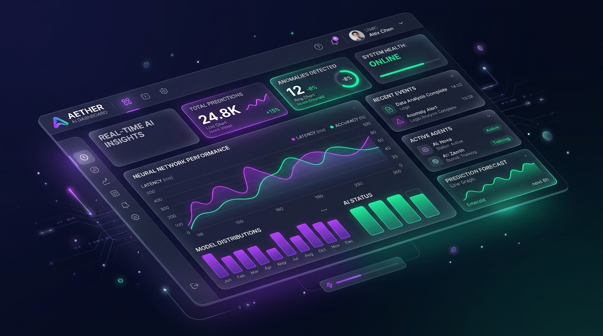

# 🚀 Modern Developer Portfolio Website

A sleek, responsive, and high-performance 1-page personal developer portfolio built with semantic **HTML5**, modern **Vanilla CSS** (design tokens, glassmorphism, responsive grid), and vanilla **JavaScript**.



---

## ✨ Features

- 🌓 **Dark / Light Theme Toggle**: Seamless mode switching with preference persistence (`localStorage`).
- ⚡ **Dynamic Typewriter Subtitle**: Real-time rotating keywords animation.
- 🎨 **Glassmorphism & Rich Aesthetics**: Frosted glass effects, glowing ambient orbs, and smooth hover micro-animations.
- 📊 **Animated Stats Counter**: Numbers automatically animate on scroll into view.
- 🛠️ **Technical Arsenal (Skills)**: Categorized skill cards with animated progress bars.
- 💼 **Featured Projects Filter & Modal**:
  - Filter projects by *All*, *AI & SaaS*, *E-Commerce*, *FinTech / Web3*.
  - Full-featured case study preview modal with interactive CTAs.
- 💬 **Interactive Contact Section**:
  - 1-Click **Copy Email to Clipboard** with animated Toast notification.
  - Interactive **Contact Form** with real-time input validation, loading state, and success feedback.
- 📱 **100% Mobile & Tablet Responsive**: Optimized layout with mobile hamburger navigation drawer.
- 🔍 **SEO Ready**: Proper semantic HTML5 tags, meta descriptions, and OpenGraph social tags.

---

## 📁 Project Structure

```text
personal-portfolio/
├── index.html        # Main HTML5 structure & semantic sections
├── style.css         # Modern CSS tokens, dark/light styles, animations
├── script.js         # Theme toggle, typewriter, project modal, form logic
├── README.md         # Documentation
└── assets/           # High-resolution mockups & 3D avatar
    ├── avatar.jpg
    ├── project-ai.jpg
    ├── project-ecommerce.jpg
    └── project-fintech.jpg
```

---

## 🚀 How to Run Locally

### Option 1: Direct File Launch (No Server Needed)
Double-click `index.html` or run in terminal:
```powershell
start index.html
```

### Option 2: Python HTTP Server (Recommended)
```powershell
python -m http.server 8000
```
Then open [http://localhost:8000](http://localhost:8000) in your browser.

### Option 3: Node.js / npx Serve
```powershell
npx -y serve .
```

---

## 📄 License
MIT License. Free to use and customize for personal portfolios.
